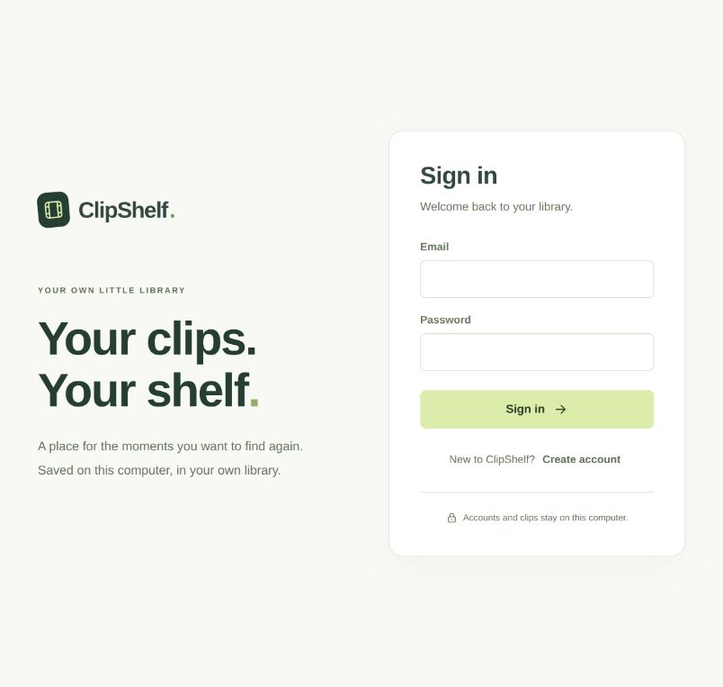

# ClipShelf

[](https://github.com/Serious-Vibe-Coding/ClipShelf/actions/workflows/tests.yml)

A small local web app for finding old video clips. Upload MP4 or MOV files, add details, and browse a personal library from your browser.

- Give each clip a title, subject, optional recording date, and notes.
- Search titles, combine subject and recording-month filters, and play clips.
- Edit details without changing the original video.
- Create local accounts with separate libraries.
- Keep accounts, clips, and edits after restarting.

ClipShelf uses Python's standard library, SQLite, and plain HTML/CSS/JavaScript. It needs no package installation, cloud account, or paid service. A fresh checkout starts empty. Recording dates stay unknown when omitted; upload dates are stored separately.



## Quick start

Requires **Python 3.10 or newer** and a browser. Linux is the tested platform.

### Download ZIP — no Git required

1. [Download ClipShelf as a ZIP](https://github.com/Serious-Vibe-Coding/ClipShelf/archive/refs/heads/main.zip), or choose **Code → Download ZIP** on this repository.
2. Extract the ZIP. Open a terminal in the extracted `ClipShelf-main` folder, which contains `server.py`.
3. Check that Python is installed with `python3 --version` (3.10 or newer), then start the app:

   ```bash
   python3 server.py
   ```

No `pip install`, API key, or GitHub sign-in is needed. Create your own local account in the browser; downloaded copies contain no existing accounts or clips.

### Or clone with Git

```bash
git clone https://github.com/Serious-Vibe-Coding/ClipShelf.git
cd ClipShelf
python3 server.py
```

### Open your library

Open [http://127.0.0.1:8765](http://127.0.0.1:8765), choose **Create account**, and enter a name, email, and password of at least six characters. Your library starts empty. The email is a local sign-in identifier; the app sends no email.

Keep the terminal running. Press **Ctrl+C** there to stop, then run `python3 server.py` again to resume with the same saved data. Closing the browser does not stop the server.

If the port is busy:

```bash
python3 server.py --port 8766
```

To use a separate data folder:

```bash
python3 server.py --data-dir .local/another-library --port 8766
```

Use the same `--data-dir` when restarting that library.

## Local accounts and storage

The server binds only to `127.0.0.1`. Each account's clips, searches, filter options, edits, and playback are checked against ownership on the server. **Sign out before someone else uses the browser**; tabs share the current session. Account separation protects access through the app. Someone with operating-system access to the data folder can read its files.

By default, `data/` beside `server.py` contains:

- `library.sqlite3`: accounts, password hashes, sessions, clip ownership, and metadata. SQLite may also create `-wal` and `-shm` files while running.
- `videos/`: original uploaded video copies, named by clip ID. Moving the original source file does not affect the saved copy.

Updating the source code does not remove saved data. Keep data folders and backups out of Git. See [accounts and migration](docs/ACCOUNTS_AND_MIGRATION.md) for session behavior, optional demo setup, and older libraries.

## Back up and restore

Create a snapshot in a **new** folder:

```bash
python3 backup.py backup backups/my-snapshot
```

Append `--data-dir .local/another-library` for a different library. Backups work while the app runs: SQLite provides a consistent snapshot, then the tool copies its referenced video files and records SHA-256 checksums. A backup includes **all accounts**, password hashes, sessions, ownership, and clip details.

Restore into a **new** data folder:

```bash
python3 backup.py restore backups/my-snapshot .local/restored-library
python3 server.py --data-dir .local/restored-library --port 8766
```

Backup and restore refuse existing destinations. Restore verifies database integrity, ownership references, file sizes, and checksums. It preserves captured sessions and their expiry times rather than forcing a new sign-in. Keep backups private and store important copies on storage you control. [More backup and migration details](docs/ACCOUNTS_AND_MIGRATION.md).

## MP4 and MOV playback

Uploads accept `.mp4` and `.mov` files up to **250 MiB** each. ClipShelf validates the container structure and stores original bytes without transcoding or extracting recording dates.

Playback depends on the browser and the video's codecs. H.264 video with AAC audio in an MP4 is a common compatible combination. MOV support varies by browser and codec; a supported extension does not guarantee playback. Export a compatible copy if your browser cannot play a clip.

## Test and try examples

Run the integration suite from the repository root:

```bash
python3 -m unittest discover -s tests -v
```

Tests use temporary libraries and synthetic clips, leaving your own library unchanged. Coverage includes account isolation, uploads, search/filtering, edits, playback ranges, restart persistence, migration, and backup/restore. See the [testing guide](docs/TESTING.md) for manual examples and fixture regeneration.

Optional fictional demo-account setup is separate from normal startup:

```bash
python3 seed_demo.py --data-dir .scratch/demo-library
python3 server.py --data-dir .scratch/demo-library --port 8766
```

The fixture definitions are in [seed_demo.py](seed_demo.py). Setup creates missing demonstration accounts, backs up nonempty state first, and preserves existing passwords and saved work. It does not upload sample clips. For a personal library, use **Create account** instead.

This version does not provide transcoding, clip deletion, automatic folder scanning, or cloud sync.
